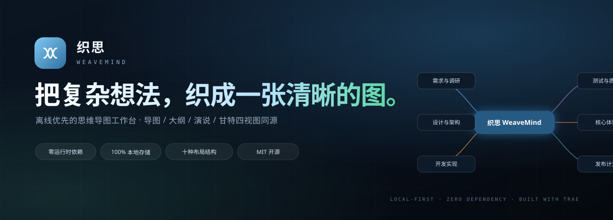
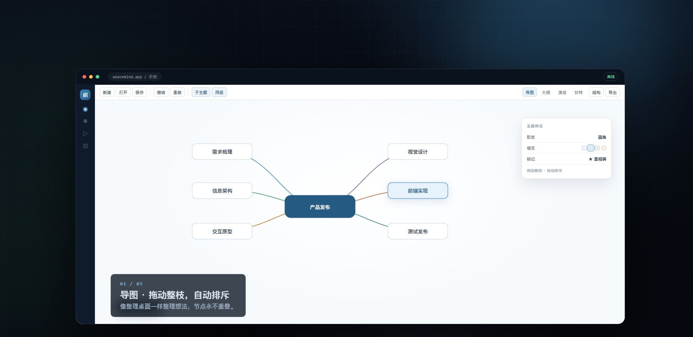
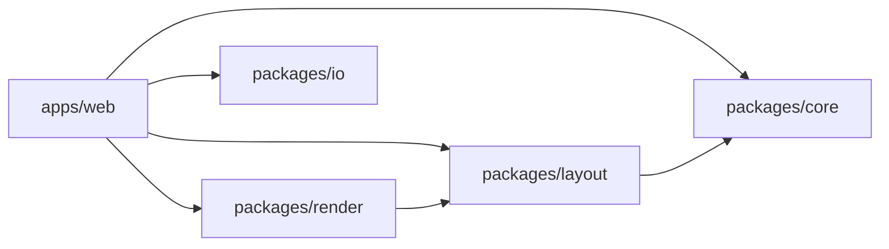

<p align="center">
  
</p>

<h1 align="center">WeaveMind</h1>

<p align="center">
  <b>Turn complex ideas into one clear map.</b><br>
  A local-first, zero-runtime-dependency mind mapping workbench.
</p>

<p align="center">
  <a href="https://www.trae.ai/"></a>
  <a href="./LICENSE"></a>
  
  <a href="./README.md"></a>
</p>

<p align="center">
  <a href="./demo/weavemind-demo.mp4"></a>
</p>

## Why WeaveMind

- **Open and use**: native ES Modules + Canvas, no install, login or network required.
- **Your data stays yours**: documents live in your browser, with no backend and no uploads.
- **One document, four views**: mind map, outline, pitch and Gantt share the same source.
- **No lock-in**: export to `.wvm`, XMind, Markdown, OPML, SVG, PNG and PDF.

## Features

- Ten structures: mind map, logic, org chart, tree, fishbone and timeline.
- Mind map / outline / pitch / Gantt views with live synchronization.
- Rich topics: notes, labels, tasks, 29 markers, LaTeX, images, attachments and audio.
- Boundaries, relationships, summaries, zones, floating topics and topic-to-topic links.
- Marquee selection, branch dragging, auto-repel, undo/redo, search and filters.
- Multiple canvases with custom title colors.
- IndexedDB storage with automatic save and browser restore.
- 16:9 pitch mode with a standalone fullscreen presentation window.
- Simplified Chinese / English UI and responsive layout.

## Quick Start

Requires Node.js 22 or newer.

```bash
git clone https://github.com/iCxin/weavemind.git
cd weavemind
npm run dev
```

Open <http://127.0.0.1:5173>. There are no third-party runtime dependencies, so `npm install` is not required.

```bash
npm test       # unit tests
npm run build  # static output in dist/
```

## Demo

- Video: [`demo/weavemind-demo.mp4`](./demo/weavemind-demo.mp4)
- Interactive demo page: [`demo/index.html`](./demo/index.html)

## Architecture



The document model is immutable with structural sharing and a 100-step history. Layout, rendering and file formats are isolated packages with one-way dependencies.

## Data & Privacy

Documents are stored in IndexedDB with a localStorage fallback. Clearing site data removes them; export `.wvm` or XMind files for long-term backup. There is no account, telemetry or remote sync.

## Deployment

The repository includes [`edgeone.json`](./edgeone.json) for one-click EdgeOne deployment. Any static host works with:

- Build: `node --experimental-strip-types tools/build-static.mjs`
- Output: `dist`

## Contributing

Issues and pull requests are welcome. Keep the project free of runtime dependencies and run `npm test` and `npm run build` before submitting.

## License

[MIT](./LICENSE)

## Acknowledgements

Built with [Trae](https://www.trae.ai/). Interaction design inspired by XMind's local workflow.
