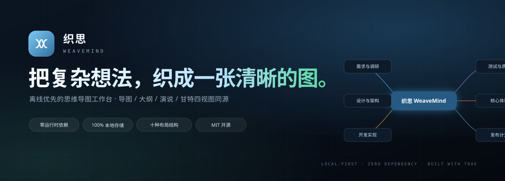
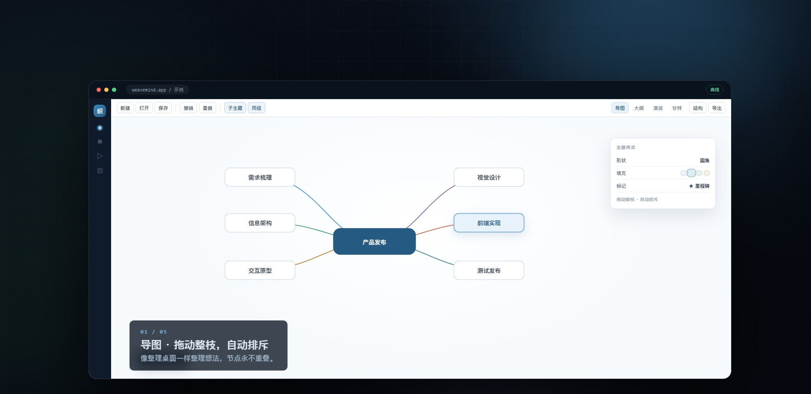
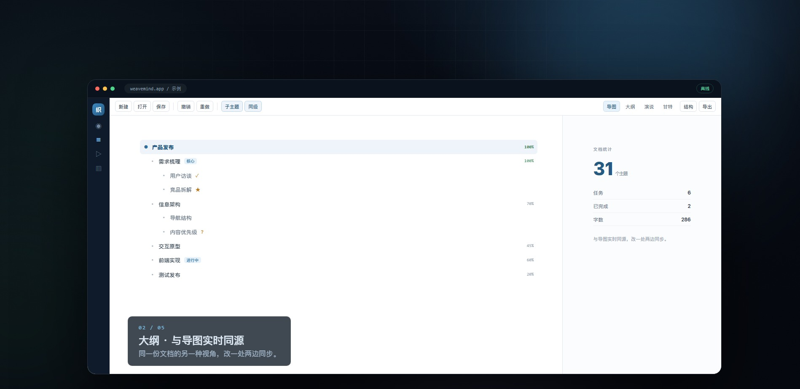
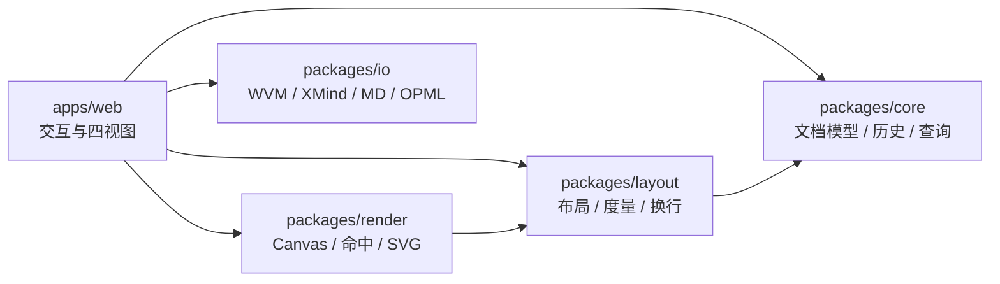

<p align="center">
  
</p>

<h1 align="center">织思 WeaveMind</h1>

<p align="center">
  <b>把复杂想法，织成一张清晰的图。</b><br>
  离线优先、零运行时依赖的思维导图工作台<br>
  导图 / 大纲 / 演说 / 甘特四视图同源
</p>

<p align="center">
  <a href="https://www.trae.ai/"></a>
  <a href="./LICENSE"></a>
  
  <a href="https://console.cloud.tencent.com/edgeone/makers/new?repository-url=https://github.com/iCxin/weavemind"></a>
  <a href="./README.en.md"></a>
</p>

<p align="center">
  <a href="#演示">演示</a> ·
  <a href="#功能">功能</a> ·
  <a href="#快速开始">快速开始</a> ·
  <a href="#快捷键">快捷键</a> ·
  <a href="#架构">架构</a> ·
  <a href="#路线图">路线图</a> ·
  <a href="./demo/index.html">演示网页</a>
</p>

<p align="center">
  <a href="./demo/weavemind-demo.mp4">
    
  </a>
  <br>
  <sub>点击画面观看 29 秒演示视频 · <a href="./demo/index.html">打开交互式演示网页</a></sub>
</p>

## 为什么是 WeaveMind

- **打开即用**：原生 ES Modules + Canvas，零第三方运行时依赖，不需要安装、登录或联网。
- **想法属于你**：文档只保存在当前浏览器，不上传服务器，也没有账号体系。
- **一份内容，四种表达**：导图、大纲、演说、甘特共享同一份文档，切换视图不产生副本。
- **格式不锁定**：`.wvm`、XMind、Markdown、OPML、SVG、PNG、PDF 随时导出。
- **为长时间思考而设计**：快速渲染、自动保存、100 步撤销、整枝拖动与自动排斥。

## 功能

| 能力 | 说明 |
| --- | --- |
| 十种结构 | 思维导图、逻辑图（左右）、组织架构（上下）、树形（左右）、鱼骨（左右）、时间轴 |
| 四种视图 | 导图、大纲、演说、甘特，同源实时同步 |
| 主题样式 | 六种形状、填充 / 文字色、粗体 / 斜体 / 下划线 / 删除线、对齐、字号、高度 |
| 富内容 | 多行文本、自动换行、备注、标签、待办、任务、29 种标记、LaTeX 公式 |
| 结构化元素 | 外框、联系、概要、专区、浮动主题、图片、附件、语音备注、主题内部链接 |
| 组织效率 | 框选、多选、整枝拖动、复制 / 剪切 / 粘贴 / 副本、查找替换、筛选、专注模式 |
| 多画布 | 新增、重命名、删除、切换画布，自定义画布名称颜色 |
| 本地存储 | IndexedDB 主存储 + localStorage 备份，自动保存与恢复 |
| 演说模式 | 16:9 思维导图逐页展开，独立演示窗口与全屏放映 |
| 多语言 | 简体中文 / English，一键切换并记住偏好 |
| 响应式 | 桌面双栏、平板抽屉、手机紧凑布局，工具栏自动折叠为 `>>>` |

## 演示

**演示视频**：[`demo/weavemind-demo.mp4`](./demo/weavemind-demo.mp4)（29 秒，1920×1080）

**演示网页**：本地运行 `npm run dev` 后访问 <http://127.0.0.1:5173/demo/index.html>，或部署后访问 `/demo/`。

<p align="center">
  
  
</p>

## 快速开始

要求 Node.js 22 或更高版本（开发服务器使用 Node 内置的 TypeScript 类型剥离能力）。

```bash
git clone https://github.com/iCxin/weavemind.git
cd weavemind
npm run dev
```

打开 <http://127.0.0.1:5173>。项目没有第三方运行时依赖，因此无需 `npm install`。

### 常用脚本

```bash
npm run dev           # 启动开发服务器
npm test              # 运行单元测试
npm run build         # 生成静态产物 dist/
npm run bench         # 运行性能基准
```

## 使用

1. **开始**：打开应用即进入示例画布，按 `Tab` 新建子主题，`Enter` 新建同级。
2. **整理**：拖动主题移动整枝，空白处拖拽框选；节点重叠时自动排斥。
3. **表达**：顶部切换大纲、演说、甘特；演说模式支持独立窗口与全屏。
4. **保存**：`Ctrl+S` 保存到浏览器，自动保存默认开启；需要迁移时使用「导出」。
5. **链接**：选中主题 → 右侧「链接主题」→ 搜索目标主题，可在画布之间跳转。

## 快捷键

| 操作 | 快捷键 |
| --- | --- |
| 新建 / 打开 / 保存 | `Ctrl+N` / `Ctrl+O` / `Ctrl+S` |
| 撤销 / 重做 | `Ctrl+Z` / `Ctrl+Shift+Z` |
| 子主题 / 同级主题 | `Tab` / `Enter` |
| 编辑选中主题 | `F2` 或空格 |
| 删除主题 | `Delete` / `Backspace` |
| 复制 / 剪切 / 粘贴 / 副本 | `Ctrl+C` / `Ctrl+X` / `Ctrl+V` / `Ctrl+D` |
| 画布缩放 | `Ctrl+=` / `Ctrl+-` |
| 框选 | 空白处拖拽（右 → 左为交叉选择） |
| 平移画布 | 中键拖拽或滚轮 |
| 演说翻页 | `←` / `→` / `Space` |
| 退出专注 / 关闭面板 | `Esc` |

## 架构



- **不可变文档模型**：每次编辑生成新版本，结构共享，配合 100 步历史记录实现可靠撤销。
- **分层设计**：`core` 描述数据，`layout` 计算几何，`render` 负责绘制，`apps/web` 处理交互，层间单向依赖。
- **双 Canvas 渲染**：静态层与交互层分离，按视口剔除，并提供三档细节层级（LOD）。
- **零运行时依赖**：开发时由 Node 剥离 TypeScript 类型，浏览器直接运行原生 ES Modules。
- **本地优先**：没有后端与账号体系，文档仅保存在当前浏览器。

## 项目结构

```text
apps/web          应用主控、四视图、属性面板、导入导出、本地存储与多语言
packages/core     文档模型、不可变更新、历史记录、查询、富文本、LaTeX
packages/layout   十种结构布局、文本度量与换行、自动排斥
packages/render   Canvas 渲染、命中测试、框选、SVG 导出
packages/io       .wvm、XMind、Markdown、OPML 编解码
demo              介绍页、交互式演示与演示视频
tools             开发服务器、静态构建、基准与按钮审计脚本
```

## 数据与隐私

文档保存在浏览器的 IndexedDB 中，并以 localStorage 作为兼容备份。清除站点数据会同时删除已保存的文档，请在需要长期保留时导出 `.wvm` 或 XMind 文件。

项目没有后端、账号、埋点或远程同步；导出文件也只会在你主动操作时生成。

## 部署

```bash
npm run build
```

构建产物输出到 `dist/`，可直接部署到任意静态托管服务。

仓库内置 [`edgeone.json`](./edgeone.json)，在 EdgeOne Makers 中导入本仓库即可一键部署：

- 构建命令：`node --experimental-strip-types tools/build-static.mjs`
- 输出目录：`dist`
- Node 版本：22

也可以使用 GitHub Pages、Cloudflare Pages、Netlify、Vercel 等平台，构建命令与输出目录相同。

## 路线图

- [x] 四视图、十种结构、多画布
- [x] 本地自动保存与浏览器恢复
- [x] XMind / Markdown / OPML / SVG / PNG / PDF 互通
- [x] 多语言、响应式界面、自定义下拉与右键菜单
- [x] 16:9 演说模式与独立演示窗口
- [x] 图片 / 附件 / 语音与主题内部链接
- [ ] 文档管理器与历史版本
- [ ] 模板中心与新手引导
- [ ] PWA 离线安装与移动端手势
- [ ] Tauri 桌面应用

## 参与贡献

欢迎提交 Issue 与 Pull Request。请保持零运行时依赖，并在提交前运行：

```bash
npm test
npm run build
```

如果这个项目对你有帮助，欢迎点一个 Star。

## Star History

[](https://star-history.com/#iCxin/weavemind&Date)

## 许可证

本项目基于 [MIT License](./LICENSE) 开源。

## 致谢

- 使用 [Trae](https://www.trae.ai/) 构建。
- 交互与功能设计参考 XMind 的本地工作流。
- 感谢所有贡献者与早期使用者。
